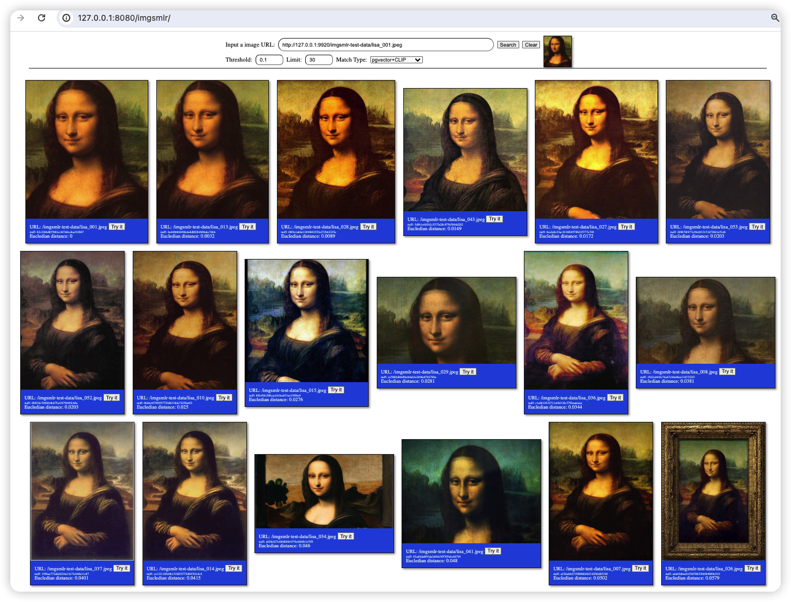
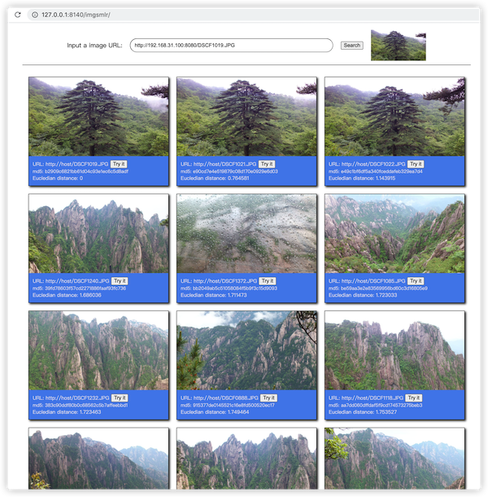
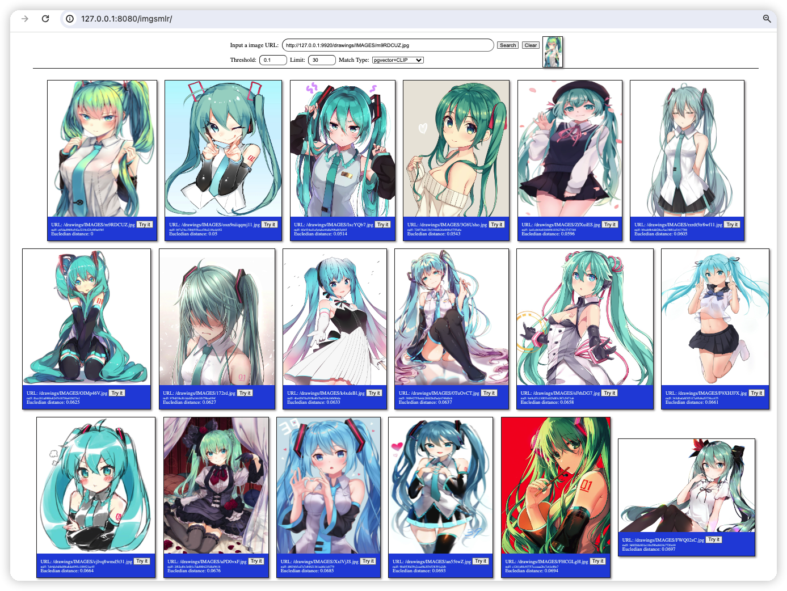

# ImgSmlr Server

A powerful image similarity search service built on PostgreSQL with `imgsmlr` and `pgvector` extensions. The service provides comprehensive image search capabilities including image-to-image search, text-to-image search, and advanced dataset management.

## Features

* **Multiple AI Models**: Supports `imgsmlr`, `CLIP`, and `SigLIP` algorithms for image feature extraction
* **Text-to-Image Search**: Search images using natural language descriptions (via CLIP)
* **Dataset Management**: Organize images into datasets for better management and scoped searches
* **Image-to-Image Search**: Find similar images using reference images
* **Flexible API**: RESTful API with comprehensive image and dataset management endpoints
* **High Performance**: Built on PostgreSQL with optimized vector operations

## Supported Models

* **imgsmlr**: Fast traditional image feature matching
* **CLIP**: OpenAI's Contrastive Language-Image Pre-Training model for image-text understanding
* **SigLIP**: Google's Sigmoid Loss for Language Image Pre-Training model for enhanced image-text matching

## API Documentation

For detailed API usage, please refer to:

* **English**: [API-EN.md](./API-EN.md) - Complete API documentation in English
* **中文**: [API-CN.md](./API-CN.md) - 完整的中文 API 文档

## References

* [https://github.com/postgrespro/imgsmlr](https://github.com/postgrespro/imgsmlr)
* [https://github.com/jie123108/libimgsmlr](https://github.com/jie123108/libimgsmlr)
* [Contrastive Language-Image Pre-Training](https://github.com/openai/CLIP)
* [SigLIP: Sigmoid Loss for Language Image Pre-training](https://arxiv.org/abs/2303.15343)

## Getting Started

### Download source code

```bash
git clone https://github.com/jie123108/imgsmlr-server
cd imgsmlr-server
```

### Init database

#### Start by docker-compose

```shell
docker-compose up -d
```

If you want to install and start the database yourself, please follow the online tutorial to install the `imgsmlr` extension. And use `scripts/imgsmlr_init.sql` to initialize the database.

#### Access the database

```bash
docker exec -ti imgsmlr-server_postgres_1 psql -U imgsmlr -d imgsmlr
```

### Start the server

```bash
pip install -r requirements.txt
python img-smlr-server.py
```

If the default configuration does not start properly. Please modify the configuration in `config.py` according to the actual situation.

## Quick Start Examples

### 1. Create a Dataset

First, create a dataset to organize your images:

```bash
curl -X POST http://127.0.0.1:8140/imgsmlr/dataset/add \
  -H "Content-Type: application/json" \
  -d '{
    "name": "my_dataset",
    "description": "My first image dataset"
  }'
```

### 2. Add Images

Add images to your dataset:

```bash
curl -X POST http://127.0.0.1:8140/imgsmlr/image/add \
  -H "Content-Type: application/json" \
  -d '{
    "url": "https://example.com/image.jpg",
    "datasetId": 1,
    "dataId": "img_001",
    "remark": "Sample image"
  }'
```

### 3. Search Similar Images

Search for similar images using different methods:

#### Image-to-Image Search (CLIP)

```bash
curl -X POST http://127.0.0.1:8140/imgsmlr/image/search \
  -H "Content-Type: application/json" \
  -d '{
    "url": "https://example.com/query.jpg",
    "matchType": "clip",
    "threshold": 0.8,
    "limit": 10
  }'
```

#### Text-to-Image Search

```bash
curl -X POST http://127.0.0.1:8140/imgsmlr/image/search \
  -H "Content-Type: application/json" \
  -d '{
    "url": "a beautiful sunset over mountains",
    "matchType": "cliptext",
    "threshold": 0.8,
    "limit": 10
  }'
```

#### Response Example

```json
{
  "code": 200,
  "msg": "OK",
  "data": {
    "images": [
      {
        "id": 101,
        "url": "https://example.com/similar1.jpg",
        "dataId": "img_001",
        "datasetId": 1,
        "md5": "abc123def456",
        "remark": "Similar image",
        "meta": {"category": "demo"},
        "simr": 0.95
      }
    ],
    "threshold": 0.8
  }
}
```

## Model-Specific Guidelines

### Similarity Threshold Recommendations

Different models require different threshold settings for optimal performance:

* **imgsmlr**: Threshold range 0-1 (0.9) for high precision, extend to 2 for higher recall
* **CLIP**: Cosine distance threshold 0-0.1 for high precision, 0.1-0.2 for higher recall  
* **SigLIP**: Similar to CLIP, threshold range 0-0.1 for optimal results
* **Text-to-Image (cliptext)**: Threshold range 0-0.1, adjust based on text query complexity

### Match Type Options

* `imgsmlr`: Traditional fast image feature matching
* `clip`: CLIP model for general image similarity
* `siglip`: SigLIP model for enhanced image-text matching
* `cliptext`: Text-to-image search using natural language
* `dataId`: Exact matching based on custom data ID

**Tip**: Test with your actual data to find the optimal threshold for your use case.

## Web Interface

You can test the image search function through the web interface by visiting `http://127.0.0.1:8140/imgsmlr/`.

### Demo Screenshots

|  |
|:--:|
| *Image Upload Interface* |

|  |
|:--:|
| *Search Results Display* |

|  |
|:--:|
| *Similar Images Found* |

|  |
|:--:|
| *Detailed View* |

## Additional Features

* **Dataset Management**: Organize images into logical groups
* **Batch Operations**: Add multiple images efficiently  
* **Metadata Support**: Store custom metadata with images
* **Tag System**: Tag images for better organization
* **Multiple Format Support**: Works with various image formats
* **RESTful API**: Clean, documented API for integration

## LICENSE

[MIT](./LICENSE)
